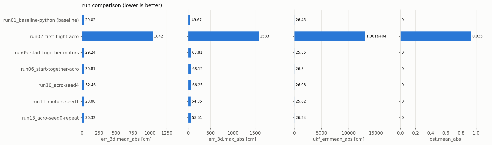

# Run comparison

Generated 2026-11-01 21:34 by pa.py compare. Errors: lower is better. Δ is the change against the baseline run.

| Run | What changed | err_3d.mean_abs [cm] | err_3d.max_abs [cm] | ukf_err.mean_abs [cm] | lost.mean_abs | position_latency.mean_abs [ms] | command_latency.mean_abs [ms] | Δ err_3d.mean_abs vs baseline | Verdict | Plots |
|---|---|---|---|---|---|---|---|---|---|---|
| 2026-11-01_run01_baseline-python (baseline) | Python NOVA_PAMPC pipeline: the reference | 29.02 | 49.67 | 26.45 | 0 | n/a | n/a | - | baseline: 29.02 cm mean, 0 lost | [plots](runs/2026-11-01_run01_baseline-python/plots) |
| 2026-11-01_run02_first-flight-acro | startup bug: controller flew on default attitude | 1042 | 1583 | 1.301e+04 | 0.935 | 13.85 | 2.976 | +3490.8 % | superseded by the fix; 1042.17 cm; trace metrics out: rows,pT_mean_m,pT_max_m,pT_final_m,vT_mean_ms,u_mean | [plots](runs/2026-11-01_run02_first-flight-acro/plots) |
| 2026-11-01_run05_start-together-motors | motors, startup fixed | 29.24 | 63.81 | 25.85 | 0 | 0.7 | 2.466 | +0.7 % | 29.24 cm; trace metrics out: pT_max_m,u_mean | [plots](runs/2026-11-01_run05_start-together-motors/plots) |
| 2026-11-01_run06_start-together-acro | acro, startup fixed | 30.81 | 68.12 | 26.3 | 0 | 0.7463 | 2.471 | +6.2 % | 30.81 cm; trace metrics out: pT_mean_m,pT_max_m,u_mean | [plots](runs/2026-11-01_run06_start-together-acro/plots) |
| 2026-11-01_run10_acro-seed4 | acro seed 4 | 32.46 | 66.25 | 26.98 | 0 | 4.15 | 2.113 | +11.9 % | FAIL 32.46 cm: 270 ms stall at t=10.2 s; two repeats passed; 32.46 cm; trace metrics out: pT_mean_m,pT_max_m,vT_mean_ms,u_mean | [plots](runs/2026-11-01_run10_acro-seed4/plots) |
| 2026-11-01_run11_motors-seed1 | motors seed 1 | 28.88 | 54.35 | 25.62 | 0 | 0.6468 | 1.978 | -0.5 % | 28.88 cm; trace metrics same | [plots](runs/2026-11-01_run11_motors-seed1/plots) |
| 2026-11-01_run13_acro-seed0-repeat | acro seed 0 repeat | 30.32 | 58.51 | 26.24 | 0 | 0.2985 | 1.943 | +4.5 % | 30.32 cm; trace metrics out: pT_mean_m,pT_max_m,u_mean | [plots](runs/2026-11-01_run13_acro-seed0-repeat/plots) |

