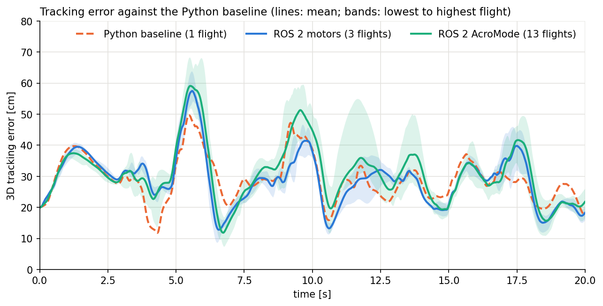
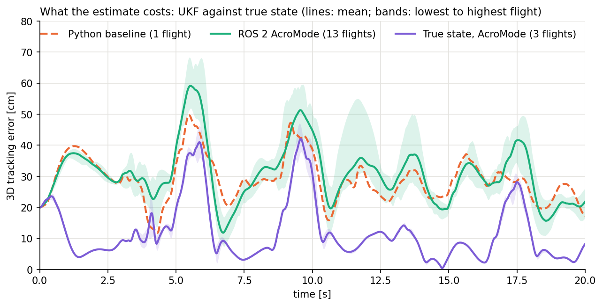

# Tracking error against the Python baseline

Lissajous at 3 m/s, t = 0 to 20 s. Cells are the mean over flights (lowest to highest flight).

| Setup | Flights | Mean 3D error (cm) | Change from baseline (cm) | RMSE (cm) | Peak (cm) | Last 2 s (cm) |
|---|---|---|---|---|---|---|
| Python baseline | 1 | 29.08 | +0.00 | 29.98 | 49.7 | 22.82 |
| ROS 2 motors | 3 | 28.96 (28.76 to 29.24) | -0.12 | 30.27 (29.96 to 30.62) | 57.7 (54.3 to 63.8) | 19.05 (18.56 to 19.85) |
| ROS 2 AcroMode | 13 | 30.90 (29.46 to 32.47) | +1.81 | 32.43 (30.89 to 34.31) | 60.9 (52.2 to 68.3) | 20.31 (16.87 to 24.34) |
| ROS 2 AcroMode, windows on | 7 | 31.38 (30.15 to 33.43) | +2.29 | 33.09 (31.79 to 35.56) | 61.3 (54.9 to 70.5) | 20.23 (16.80 to 24.51) |
| True state, motors | 3 | 12.01 (10.81 to 13.26) | -17.07 | 14.93 (13.56 to 16.49) | 40.4 (36.7 to 44.2) | 6.38 (5.53 to 6.95) |
| True state, AcroMode | 3 | 12.13 (11.80 to 12.49) | -16.96 | 15.50 (14.89 to 16.13) | 44.2 (39.4 to 47.0) | 4.84 (4.67 to 4.94) |

## Mean error by flight phase (cm)

| Setup | 0 to 5 s | 5 to 10 s | 10 to 15 s | 15 to 20 s |
|---|---|---|---|---|
| Python baseline | 28.4 | 34.4 | 26.2 | 27.4 |
| ROS 2 motors | 31.1 | 32.1 | 25.7 | 27.0 |
| ROS 2 AcroMode | 30.2 | 36.3 | 29.6 | 27.5 |
| ROS 2 AcroMode, windows on | 30.4 | 37.9 | 29.5 | 27.7 |
| True state, motors | 10.7 | 17.4 | 9.4 | 10.6 |
| True state, AcroMode | 11.2 | 18.8 | 9.1 | 9.4 |

## 2D and 3D tracking error (cm)

2D ignores height. The 3 m/s rows are as above; the 2 m/s rows are one flight each.

| Setup | Flights | Mean 2D | Max 2D | Mean 3D | Max 3D |
|---|---|---|---|---|---|
| Python baseline | 1 | 15.89 | 32.5 | 29.08 | 49.7 |
| ROS 2 motors | 3 | 14.96 | 34.4 | 28.96 | 57.7 |
| ROS 2 AcroMode | 13 | 17.54 | 35.7 | 30.90 | 60.9 |
| ROS 2 AcroMode, windows on | 7 | 17.75 | 39.1 | 31.38 | 61.3 |
| True state, motors | 3 | 5.44 | 23.7 | 12.01 | 40.4 |
| True state, AcroMode | 3 | 4.68 | 22.1 | 12.13 | 44.2 |
| Python baseline, 2 m/s | 1 | 18.05 | 42.0 | 28.15 | 44.5 |
| ROS 2 AcroMode, 2 m/s | 1 | 18.77 | 44.0 | 28.87 | 48.9 |

